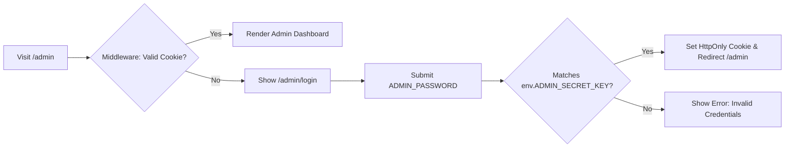

# Rankup — Admin Dashboard, Moderation & Security Specification

## 1. Overview & Authentication Model

While Rankup is a zero-auth platform for public visitors, platform administrators require a secure, lightweight dashboard to moderate listings, audit Paddle webhook payments, manage blacklists, and inspect revenue.

### Authentication Architecture:
* **Zero-Database Users**: Admin authentication does **not** require a complex user management table or OAuth provider.
* **Environment Secret**: Admin access is governed by an environment variable (`ADMIN_SECRET_KEY` or `ADMIN_PASSWORD`).
* **Middleware Session Guard**: Next.js Middleware inspects an encrypted `HttpOnly` cookie (`rankup_admin_session`). If valid, access to `/admin/*` routes is granted; otherwise, redirects to `/admin/login`.



---

## 2. Admin Dashboard Capabilities & Modules

The Admin Panel is divided into 4 primary views:

### 2.1 Overview & Financial Analytics (`/admin`)
* **Live KPI Cards**:
  - **Gross Revenue**: All-time USD cumulative spend.
  - **Today's Revenue**: Spend since 00:00:00 UTC.
  - **Active Listings**: Count of active placements (`status = 'active'`).
  - **Average Paid Per Listing**: Cumulative spend / total paid listings.
  - **Boost Window Conversion Rate**: Percentage of buyers who boosted or reclaimed during their 15-minute window.
* **Top Performing Categories**: Ranking of categories by revenue and listing count.

### 2.2 Listings Management (`/admin/listings`)
* **Search & Filters**:
  - Search by: Product Title, Domain, X handle, or Listing ID.
  - Filter by Status: `Active`, `Archived`, `Pending Payment`, `Removed`.
  - Filter by Category.
* **Quick Actions on Listings**:
  - **Edit Metadata**: Adjust Title, Description, Image URL, or reassign Category.
  - **Force Archive**: Manually move an active listing to `archived` before 7 days.
  - **Hard Remove**: Set `status = 'removed'` (hides from public site completely).
  - **Blacklist Domain**: Add the domain directly to the blacklist with 1 click.

### 2.3 Payments & Webhook Audit Logs (`/admin/payments`)
* **Transaction Table**:
  - Paddle Event ID, Transaction ID, Buyer Email, Amount USD, Timestamp, Status (`succeeded`, `pending`, `failed`).
* **Raw Payload Inspector**:
  - Click on any payment to view the complete JSON webhook received from Paddle.
* **Manual Retry Button**:
  - If a webhook failed due to a temporary network issue, admin can trigger a re-execution of `process_successful_payment` directly from the UI.

### 2.4 Blacklist & Moderation Engine (`/admin/blacklist`)
* List of banned domains, X handles, and prohibited keyword regexes.
* Ability to quickly add a new pattern (e.g., `*.t.me`, `scamsite.com`).

---

## 3. Moderation Rules & Content Safety

Because Rankup is an open, paid platform, strict moderation is mandatory to protect users and preserve payment provider compliance.

### 3.1 Prohibited Content (Instant Rejection / Removal)

| Category | Disallowed Patterns | Action |
|---|---|---|
| **Direct Chat Invites** | Telegram (`t.me/*`), WhatsApp (`wa.me/*`), Discord (`discord.gg/*`), Signal | Auto-rejected during URL input |
| **Malware & Phishing** | Parked domains, fake login portals, known malicious domains | Auto-flagged and removed |
| **Adult / NSFW** | Pornography, escort services, sexual content | Banned immediately without refund |
| **Link Shorteners** | `bit.ly`, `tinyurl.com`, `t.co`, `cutt.ly`, etc. | Must resolve to final destination or be rejected |
| **Illegal Goods / Services** | Drugs, weapons, unauthorized financial schemes | Immediate removal and domain blacklisted |

### 3.2 Automated URL Input Validator
```typescript
const DISALLOWED_DOMAINS = [
  't.me', 'telegram.me', 'wa.me', 'chat.whatsapp.com',
  'discord.gg', 'discord.com/invite', 'bit.ly', 'tinyurl.com'
];

export function validateDestinationUrl(url: string): { isValid: boolean; error?: string } {
  try {
    const parsed = new URL(url.startsWith('http') ? url : `https://${url}`);
    const host = parsed.hostname.toLowerCase();

    for (const banned of DISALLOWED_DOMAINS) {
      if (host === banned || host.endsWith(`.${banned}`)) {
        return {
          isValid: false,
          error: `Direct invite links and link shorteners (${banned}) are not permitted.`
        };
      }
    }

    return { isValid: true };
  } catch {
    return { isValid: false, error: 'Please enter a valid website URL.' };
  }
}
```

---

## 4. Mandatory Legal Disclaimers

To protect the platform legally and adhere to FTC and consumer protection standards:
* Every listing card, product detail page, and leaderboard footer must display:
  > **"Sponsored placement. Rank is determined by payment, not editorial review."**
* Refund Policy must be linked prominently in the checkout flow:
  > **"All payments are final and non-refundable. Paid placement does not guarantee conversions, permanent rank, or immunity from being outbid."**
