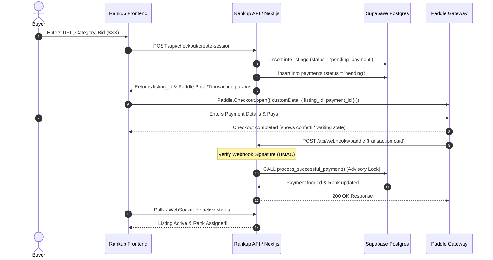

# Rankup — Paddle Payment & Webhook Architecture Specification

## 1. Overview & Architecture

Rankup uses **Paddle Billing** as its Merchant of Record (MoR). 
* **Zero-Auth Compatibility**: Buyers do not need to register on Rankup. Paddle handles buyer email collection, sales tax / VAT compliance, currency conversion, and fraud prevention.
* **Security Principle**: Rank assignment **NEVER** trusts frontend success callbacks. Ranks and spend totals are exclusively credited upon server-to-server verification of Paddle's `transaction.paid` webhook.



---

## 2. Paddle Checkout Configuration

### 2.1 Custom Data Payload
When opening Paddle Checkout from the client, critical tracking metadata is injected into `customData`:

```typescript
Paddle.Checkout.open({
  settings: {
    displayMode: 'overlay',
    theme: 'dark',
    locale: 'en',
    successUrl: `${window.location.origin}/success?listing_id=${listingId}`,
  },
  items: [
    {
      priceId: process.env.NEXT_PUBLIC_PADDLE_CUSTOM_PRICE_ID, // Dynamic price or tiered catalog item
      quantity: 1,
    }
  ],
  customData: {
    listing_id: listingId,
    pending_payment_id: paymentId,
    bid_amount_usd: amountInUsd,
    platform: 'rankup'
  }
});
```

---

## 3. Webhook Handling & Signature Verification

Paddle sends webhook notifications as HTTP POST requests with a signature header: `Paddle-Signature`.

### 3.1 Signature Verification Logic
```typescript
import crypto from 'crypto';

export function verifyPaddleWebhook(
  rawBody: string,
  signatureHeader: string,
  webhookSecretKey: string
): boolean {
  try {
    // Header format: ts=1672531199;h1=abcdef...
    const parts = signatureHeader.split(';');
    const tsPart = parts.find(p => p.startsWith('ts='));
    const h1Part = parts.find(p => p.startsWith('h1='));

    if (!tsPart || !h1Part) return false;

    const timestamp = tsPart.split('=')[1];
    const signature = h1Part.split('=')[1];

    // Prevent replay attacks (reject webhooks older than 5 minutes)
    const currentTime = Math.floor(Date.now() / 1000);
    if (Math.abs(currentTime - parseInt(timestamp, 10)) > 300) {
      return false;
    }

    // Build signed payload
    const signedPayload = `${timestamp}:${rawBody}`;
    const expectedSignature = crypto
      .createHmac('sha256', webhookSecretKey)
      .update(signedPayload)
      .digest('hex');

    return crypto.timingSafeEqual(
      Buffer.from(signature, 'hex'),
      Buffer.from(expectedSignature, 'hex')
    );
  } catch (err) {
    console.error('Paddle signature verification failed:', err);
    return false;
  }
}
```

---

## 4. Idempotency & Database Transaction

Paddle webhooks are delivered with "at-least-once" guarantees and may arrive out of order or duplicated.

### 4.1 Strict Idempotency Engine
* Every webhook delivery includes an `event_id` (e.g., `evt_01h8...`).
* The `payments` table has a `unique` constraint on `paddle_event_id`.
* If `insert into payments ... on conflict (paddle_event_id) do nothing` affects 0 rows, the server immediately returns `200 OK` and stops execution.

### 4.2 Webhook Route Handler (`/api/webhooks/paddle`)
```typescript
import { NextRequest, NextResponse } from 'next/server';
import { supabaseAdmin } from '@/lib/supabase/admin';
import { verifyPaddleWebhook } from '@/lib/paddle/verify';

export async function POST(req: NextRequest) {
  const rawBody = await req.text();
  const signature = req.headers.get('paddle-signature') || '';
  const secretKey = process.env.PADDLE_WEBHOOK_SECRET_KEY!;

  // 1. Verify Signature
  const isValid = verifyPaddleWebhook(rawBody, signature, secretKey);
  if (!isValid) {
    return NextResponse.json({ error: 'Invalid webhook signature' }, { status: 401 });
  }

  const event = JSON.parse(rawBody);

  // 2. Filter for relevant event
  if (event.event_type !== 'transaction.paid') {
    return NextResponse.json({ message: 'Event ignored' }, { status: 200 });
  }

  const transaction = event.data;
  const customData = transaction.custom_data || {};
  const listingId = customData.listing_id;
  const eventId = event.event_id;
  const transactionId = transaction.id;
  const customerEmail = transaction.customer?.email || null;
  const amountUsd = Math.round(parseFloat(transaction.details.totals.total) / 100);

  // 3. Execute Postgres transaction with Advisory Lock and pending payment validation
  const { data: result, error } = await supabaseAdmin.rpc('process_successful_payment', {
    p_payment_id: customData.payment_id,
    p_listing_id: customData.listing_id,
    p_event_id: event.eventId,
    p_transaction_id: transaction.id,
    p_email: customerEmail,
    p_paid_minor: paidMinor,
    p_payload: event
  });

  if (error) {
    console.error('Payment processing DB error:', error);
    return NextResponse.json({ error: 'Database processing failed' }, { status: 500 });
  }

  return NextResponse.json({ success: true }, { status: 200 });
}
```

---

## 5. Non-Refundable Policy & Chargeback Handling

* **Explicit Disclosure at Checkout**: Paddle checkout displays:
  > *"All payments are final and non-refundable. Payment purchases 7 days of placement based on cumulative spend and does not guarantee clicks, immunity from outbids, or permanent rank."*
* **Chargebacks / Disputes**:
  - If a `dispute.created` or `transaction.refunded` webhook is received from Paddle:
  - System immediately marks the listing as `status = 'removed'`.
  - The domain / X handle is automatically added to the `blacklist` table.
  - Spend is deducted from `listing_spend` to maintain leaderboard integrity.
