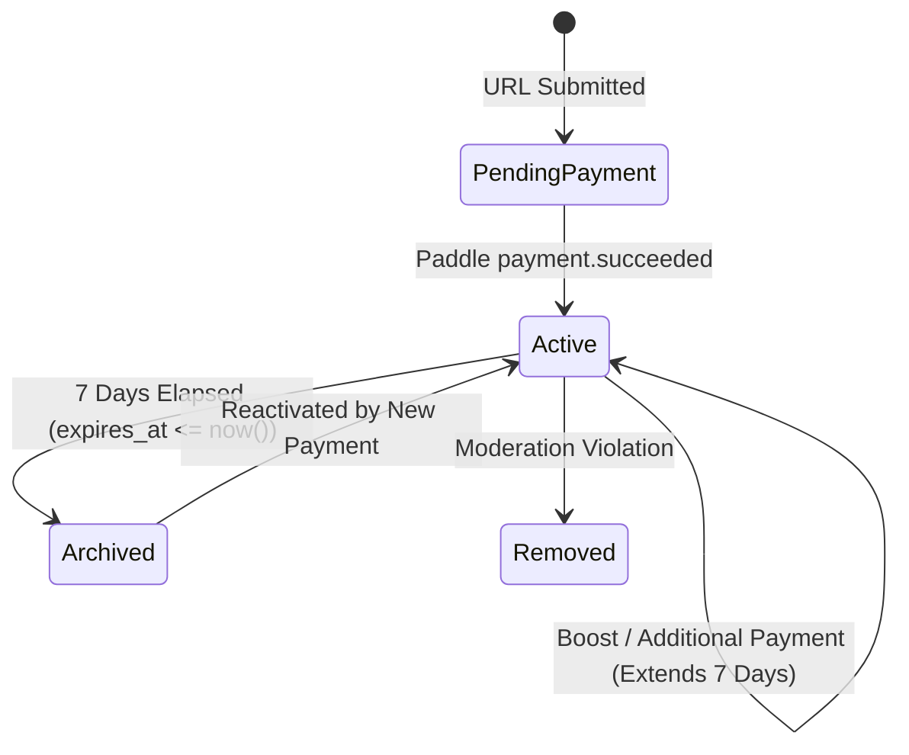

# Rankup — Ranking Logic, Mathematical Algorithms & Lifecycle Rules

## 1. Core Principles & Philosophy

**Rankup** operates under a pure, transparent, paid placement mechanism:
* **Pay-to-Rank**: The rank position is strictly mathematical. Editorial staff, algorithms, or organic traffic play zero role in ranking.
* **Whole Dollar Increments**: Minimum bid is **$5 USD**, maximum is **$99,999 USD**. No fractional cents allowed.
* **Active Window (7 Days)**: Every payment grants **7 full days (168 hours)** of active leaderboard visibility.
* **Archived State**: When 7 days elapse without renewal, a listing automatically moves to the public archive. Historical rank and cumulative spend are permanently preserved.

---

## 2. Board Sorting & Ranking Algorithms

### 2.1 The All-Time Leaderboard
Ranks all currently active listings by their cumulative lifetime spend on Rankup:

```sql
select 
  l.id,
  l.title,
  l.slug,
  l.favicon_url,
  l.destination_url,
  l.category_id,
  s.all_time_total,
  l.first_paid_at,
  l.expires_at,
  row_number() over (
    order by s.all_time_total desc, l.first_paid_at asc
  ) as current_rank
from listings l
join listing_spend s on l.id = s.listing_id
where l.status = 'active'
  and l.expires_at > now();
```

#### Tie-Breaking Rule (All-Time):
If Listing A and Listing B have paid identical cumulative amounts (e.g., both at $150):
* The listing with the **earlier `first_paid_at` timestamp** ranks higher.
* *Seniority advantage encourages earlier participation.*

---

### 2.2 The Today Leaderboard
Ranks listings based solely on the amount paid during the current **UTC calendar day** (00:00:00 UTC to 23:59:59 UTC):

```sql
select 
  l.id,
  l.title,
  l.slug,
  l.favicon_url,
  l.destination_url,
  s.today_total,
  s.last_paid_at as first_payment_today_at,
  row_number() over (
    order by s.today_total desc, s.last_paid_at asc
  ) as today_rank
from listings l
join listing_spend s on l.id = s.listing_id
where l.status = 'active'
  and s.today_date = current_date
  and s.today_total > 0;
```

#### Midnight UTC Reset Rule:
1. At exactly `00:00:00 UTC`, the daily board freezes.
2. A snapshot is captured as a permanent read-only archive at `/archive/[yyyy-mm-dd]`.
3. `today_total` for all listings is reset to `0`, and `today_date` updates to the new UTC date.
4. The first person to spend $5 on the new day immediately takes `#1 Today`.

---

### 2.3 Category Leaderboards
Each of the 20 categories has its own All-Time and Today boards. The mathematical logic is identical, with the query filtered by `category_id`:

```sql
where l.category_id = :target_category_id
  and l.status = 'active'
  and l.expires_at > now()
```

---

## 3. The #1 Takeover Algorithm (+$2 Minimum Rule)

In Rankup, taking the coveted `#1` position requires beating the current `#1` cumulative total by at least **$2 USD**.

### Mathematical Formula:

```typescript
function calculateTakeoverPrice(
  currentLeaderSpend: number,
  userCurrentCumulativeSpend: number = 0
): { requiredSpendTotal: number; amountToPay: number } {
  // If board is empty, default minimum is $5
  if (!currentLeaderSpend || currentLeaderSpend < 5) {
    const minBid = 5;
    return {
      requiredSpendTotal: minBid,
      amountToPay: Math.max(minBid - userCurrentCumulativeSpend, minBid)
    };
  }

  // To take #1, new cumulative total must beat current leader by $2
  const requiredSpendTotal = currentLeaderSpend + 2;
  const amountToPay = Math.max(5, requiredSpendTotal - userCurrentCumulativeSpend);

  return {
    requiredSpendTotal,
    amountToPay
  };
}
```

### Practical Scenarios:

* **Scenario A (New Listing taking #1)**:
  - Current #1 has spent: `$100`
  - Required new cumulative spend: `$102`
  - Buyer is new (0 previous spend): **Buyer pays $102**.
* **Scenario B (Existing Listing #3 boosting to #1)**:
  - Current #1 has spent: `$100`
  - Buyer currently ranks #3 with cumulative spend of: `$80`
  - Required new cumulative spend: `$102`
  - **Buyer only pays the difference**: `$102 - $80 = $22`.

---

## 4. The 15-Minute Boost Window Engine

The **Boost Window** is Rankup's flagship retention and dynamic bidding feature.

### 4.1 Activation Rules
* Every time a listing completes a successful Paddle payment, a **15-minute countdown timer** begins:
  ```text
  boost_window_expires_at = payment_timestamp + 15 minutes
  ```
* During this 15-minute window, the listing owner has guaranteed **Discounted Reclaim Privileges**.

### 4.2 Reclaim Privilege Logic
If another user outbids the listing during its active 15-minute Boost Window:
1. The original listing drops in rank.
2. An instant outbid alert is triggered (real-time on-site banner + webhook email).
3. The original buyer can reclaim the rank by paying **only the difference required to overtake by $2**.

#### Detailed Reclaim Example:
1. **Minute 0**: Buyer A pays **$50** and claims `#1`. (Boost Window active until Minute 15).
2. **Minute 4**: Buyer B comes in and pays **$52**, taking `#1`. Buyer A drops to `#2`.
3. **Minute 6 (Inside Boost Window)**: Buyer A wants `#1` back.
   - Buyer B's current total: `$52`.
   - Takeover total required: `$52 + $2 = $54`.
   - Buyer A already has `$50` credited.
   - **Buyer A pays only $4** ($54 - $50 = $4) to reclaim `#1`!
   - *Note: In standard non-boost bidding, minimum transaction is $5, but during Boost Reclaim, whole dollar difference + $2 applies.*
4. **Minute 15:01 (After Window Expiry)**: Normal outbid rules resume.

---

## 5. 7-Day Active Visibility & Expiry Lifecycle



### Rules of Expiry:
1. **Extension Policy**: If a listing is currently active (e.g., 3 days remaining) and pays any additional boost amount (minimum $5), its `expires_at` is extended by **7 full days from the moment of the new payment**.
2. **Archival (Not Deletion)**: Expired listings are never deleted. Their public URL `/r/[slug]` stays live, preserving backlink equity. However, they are hidden from the primary active All-time and Today boards and tagged with an *"Inactive / Archived"* badge with a one-click *"Reactivate & Rank Up"* CTA.
