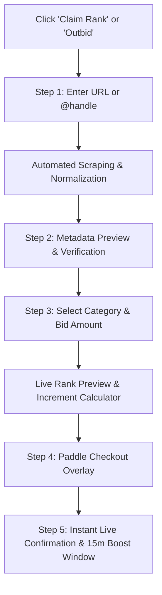

# Rankup — UI/UX Architecture & Layout Blueprints

## 1. Executive Summary & Layout Differentiation

While `outbid.lol` uses a traditional top-bar navigation layout, **Rankup** elevates the user experience by introducing a **Persistent Left Sidebar Navigation**. This provides faster navigation across 20 launch categories, keeps live board stats always in view, and gives the platform an enterprise-grade SaaS / Dashboard aesthetic.

### Layout Comparison Matrix

| Layout Feature | Reference (`outbid.lol`) | Rankup Architecture | UX Benefit |
|---|---|---|---|
| **Primary Navigation** | Top horizontal header | **Persistent Left Sidebar** (Collapsible on mobile) | Direct access to all boards, categories, and archive without scrolling back up |
| **Claim Rank CTA** | Embedded in top center hero | Dual access: **Dedicated Sidebar Quick CTA** + **Hero Claim Bar** | Constant conversion prompt regardless of page scroll |
| **Live Stats Counter** | Small text in top bar | **Interactive Mini-Widget in Sidebar** (Live users, 24h volume) | Higher credibility & constant social proof |
| **UTC Reset Clock** | Text below All-time/Today toggle | **Prominent Ticking Countdown Pill** in header & sidebar | Creates FOMO and urgent bidding behavior |
| **Brand Identity** | Minimalist retro black/orange | **Sleek Dark Slate & Royal Electric Blue** with chevron icons | Modern, fintech-grade aesthetic |
| **Boost Window Alert** | None | **Top Banner / Floating Real-Time Countdown Widget** | Highlights the 15-minute reclaim privilege |

---

## 2. Left Sidebar Navigation Architecture

The sidebar remains sticky on the left side of the screen on desktop displays (`w-64` / `260px` width) and seamlessly transitions into a bottom navigation bar or slide-out drawer on mobile devices.

### Sidebar Structure (Top to Bottom):
1. **Brand Header**:
   - `rankup-logo-dark-bg.svg` (or Light version in Light Mode) linked to `/`.
   - Live Pulse Badge: Emerald dot with "Live Board".
2. **Primary Navigation Links**:
   - 🏠 **Home / Top 10** (`/`)
   - 🏆 **All-Time Leaderboard** (`/leaderboard?board=all-time`)
   - ⚡ **Today's Board** (`/leaderboard?board=today`) — with dynamic live badge
   - 🗂️ **Explore Categories** (`/categories`) — expandable list of 20 categories
   - 📜 **Daily Archive** (`/archive`)
   - ⚖️ **Rules & How It Works** (`/rules`)
   - ℹ️ **About & Live Stats** (`/about`)
3. **UTC Reset Countdown Card**:
   - Displays real-time countdown to `00:00:00 UTC` ("Today's board resets in 07:42:15").
4. **Platform Live Stats Micro-Widget**:
   - Active listings count.
   - 24h volume / #1 takeover price.
5. **Primary Action**:
   - Full-width **"Claim a Rank"** button (Electric Blue gradient with upward chevron icon). Clicking immediately opens the Claim Modal.
6. **Sidebar Footer**:
   - Light / Dark Mode Toggle switch.
   - Mini legal links: Terms • Privacy • Sponsored Disclosure.

---

## 3. Page-by-Page UX Anatomy & Wireframes

### 3.1 Homepage (`/`)
* **Hero Section**:
  - Social Proof Banner: Live visitors online + total volume raised.
  - Dynamic Display Headline: *"Claim today's #1 for **$XX**"* with increment buttons (`-` and `+`).
  - **The Hero Claim Bar**:
    - Input: `Your product website URL or @handle`.
    - Dropdown: `Choose Category` (20 options).
    - Action: `Claim Rank` primary button.
* **Filter & Toggle Toolbar**:
  - Board Toggle: `All-Time` vs `Today` segmented control.
  - Category Pills: Horizontal scrollable chips (`All`, `AI Agents`, `SaaS`, `SEO`, `Crypto`, `Explore...`).
  - View Toggle: `Card View` (default) vs `Compact Table View`.
* **The Main Leaderboard**:
  - Cards ranked `#1` to `#10` (and expandable to top 50).
  - `#1` Card: Distinct golden border glow, larger favicon, high-visibility "Current King" styling.
  - `#2` & `#3` Cards: Silver and Bronze accent badges.
  - Card Data: Rank number, Favicon/Logo, Title, Short Description, Category Chip, Domain link, Live Click Count, Total Paid Amount, 7-Day Expiry countdown indicator, and "Outbid / Boost" button.
* **Side-Rail Mini Widget (Desktop)**:
  - Mini Top 10 All-Time quick-list.
  - Live Ticker: "Latest Activity" ticker stream showing real-time bids and boosts.
* **Trust & Education Sections**:
  - "How It Works" 3-step explainer (1. Submit URL -> 2. Pay securely -> 3. Claim your rank for 7 days).
  - Milestone stats strip (Visitors, Listings added, Total paid).
  - Collapsible FAQ.

### 3.2 Full Leaderboard Page (`/leaderboard`)
* Search bar: Instant fuzzy search by product name, handle, or domain.
* Advanced filter: Filter by category, price tier ($5-$50, $50-$200, $200+), and active status.
* View Switcher: Card View or High-density Data Table.
* Infinite scroll / pagination loading 25 listings per batch.
* Sponsored placement disclosure badge at top and bottom.

### 3.3 Category Page (`/c/[category-slug]`)
* Category Header: Icon, Category Title, Description, and active listings count.
* Board Toggle: All-Time vs Today within this specific category.
* Dedicated Category Hero: *"Be #1 in [Category Name] for $XX"*.
* Category Leaderboard listings.
* Related categories navigation chips.

### 3.4 Product Detail Page (`/r/[listing-slug]`)
* Every paid listing has a dedicated public URL for SEO and backlink value.
* **Product Header**: Large favicon, Title, Category, Outbound DOFOLLOW/NOFOLLOW link with click tracker, "Visit Site" CTA.
* **Rank Status Card**:
  - Current Rank: e.g., `#4 All-Time`, `#1 in AI Agents`.
  - Cumulative Paid: e.g., `$420 USD`.
  - Expiry Timer: Active until `[Date, Time]` (with "Renew / Extend 7 Days" CTA).
* **Interactive Boost Panel**:
  - Quick calculator: *"Pay $32 to jump from #4 to #2"*.
  - Instant Paddle checkout trigger.
* **Rank History Chart**:
  - Interactive timeline showing previous ranks and payments (`rank_events` visualization).
* **Similar Products**: Top 3 ranked competitors in the same category.

### 3.5 Daily Archive Page (`/archive` & `/archive/[yyyy-mm-dd]`)
* Date Picker / Calendar interface to browse past UTC daily leaderboards.
* Read-only view of who won #1, #2, #3 on any specific day since platform launch.
* Historical stats for that day (total bids, total daily spend).

---

## 4. Claim & Outbid Flow UX (Multi-Step Modal)

The claim flow is zero-auth (no login required) and optimized for under-60-second completion:

### Detailed Modal Steps:
1. **Step 1 — Input Destination**:
   - Clean input for Website URL (`https://...`) or X profile (`@handle`).
   - Instant validation of URL format.
2. **Step 2 — Metadata Auto-Fetch & Edit**:
   - Live loading spinner while server fetches Open Graph metadata.
   - Shows preview card: Title, Short Description, Favicon, and OG Image.
   - User can manually edit Title (max 60 chars) or Description (max 140 chars) if scraper fails or they want custom text.
3. **Step 3 — Category & Bid Selection**:
   - Category dropdown (pre-selected if opened from a category page).
   - Bid Amount selector: Pre-calculated buttons (`$5 Min`, `Take #3 ($25)`, `Take #2 ($60)`, `Take #1 ($102)` or Custom Amount).
   - System displays achievable rank immediately before payment.
4. **Step 4 — Paddle Checkout**:
   - Seamless Paddle overlay modal opens. Customer enters email and payment info.
5. **Step 5 — Celebration & Boost Window**:
   - Confetti burst animation.
   - "You are now #X on the leaderboard!"
   - **Boost Window Activated banner**: "You have 15 minutes of Boost Protection! If someone outbids you, reclaim with a $2 discount."

---

## 5. The 15-Minute Boost Window UX

The Boost Window is a game-like retention mechanism:
* **Floating Notification Bar**: After payment, a sticky bar appears at the bottom/top of the screen:
  - *"🛡️ Boost Window Active: [14:59] — Your rank is protected. Outbid alerts are live."*
* **If Outbid during Boost Window**:
  - The bar flashes amber/red with sound or vibration.
  - Text updates: *"⚠️ You were just outbid by [Competitor Name]! Reclaim #1 for only $X (Expires in [MM:SS])"*.
  - Single-click **"Reclaim Rank"** button that pre-fills the exact takeover price into Paddle checkout.
